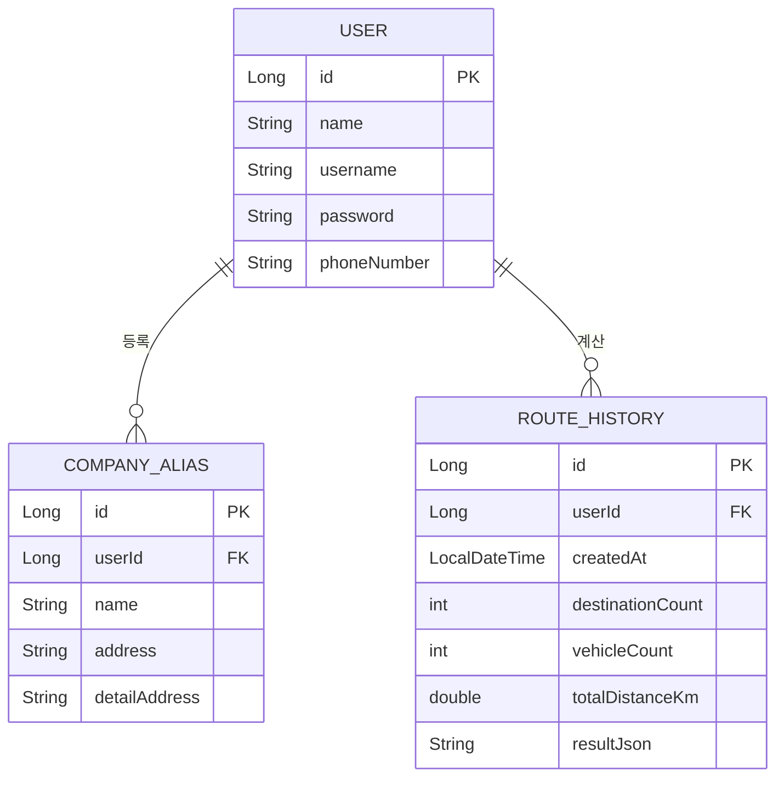

# PostalRoute

우체국 집하 차량의 동선을 자동으로 계산해주는 웹 서비스예요. 집하지 주소, 파렛 수, 요청 시간을 입력하면 시간 약속을 지키면서 이동 거리를 최대한 줄이는 차량별 방문 순서를 계산해줘요.

## ⅰ. 프로젝트 소개

### 1. 프로젝트 소개

우체국에서 근무하는 친구가 "아침마다 그날 가야 할 집하지 목록을 전달받으면, 눈대중으로 대략 동선을 짜야 해서 비효율적이고 힘들다"고 털어놓은 게 시작이었어요. 누가 짜도 비슷하게 괜찮은 동선이 나올 수 있도록, 참고할 만한 서비스가 있으면 좋겠다는 이야기를 듣고 바로 만들어보기로 했어요.

집하지 주소와 요청 시간, 파렛 수만 입력하면 시간 약속을 지키는 선에서 이동 거리가 가장 짧은 차량별 방문 순서를 자동으로 계산해주고, 실제 종이 배차표와 같은 형식의 엑셀로 바로 내려받을 수 있어요. 현재 실제 우체국 지점 발표 및 배포를 목표로 개발 중이에요.

### 2. 프로젝트 기능

**[동선 최적화]**
- 요청 시간이 있는 집하지는 그 시간 약속을 지키는 선에서 차량을 배정해요.
- 같은 시간대에 여러 곳을 가야 하면, 목적지 수가 적을 땐 모든 조합을 다 따져서 이동 거리가 가장 짧은 배정을 찾아요.
- 시간이 없는 집하지는 기존 경로에 끼워 넣었을 때 거리가 가장 적게 늘어나는 자리를 찾아 넣어요 (도착해서 싣고 내리는 시간까지 고려).
- 평파렛/롤파렛 적재 기준표를 기준으로 차량 톤수를 자동 배정하고, 한 차로 못 싣는 양이면 자동으로 여러 대로 나눠요.
- 어떤 차량에도 안 맞는 용량이면 조용히 틀린 값으로 넘어가지 않고, 화면과 엑셀에 경고로 표시해요.
- 엑셀 파일로 집하지 목록을 한 번에 가져올 수 있어요 (등록된 업체명이면 주소도 자동으로 채워줌).

**[업체 관리]**
- 자주 쓰는 업체명과 주소를 등록해두면 동선 입력할 때 이름만으로 바로 찾을 수 있어요.
- 엑셀로 한 번에 등록할 수도 있어요.

**[이력 관리]**
- 계산했던 결과를 날짜별로 조회하고, 다시 불러와서 재계산하거나 삭제할 수 있어요.

**[엑셀 다운로드]**
- 계산 결과를 실제 종이 배차표와 같은 형식(차량번호/용적/구간별 업체·시간·수량)으로 내려받을 수 있어요.

### 3. 개발 환경

**[Backend]**
- IntelliJ IDEA
- Java 17
- Spring Boot 4.1.1
- Gradle

**[Database]**
- MariaDB (로컬 개발) / Naver Cloud DB for MySQL (운영 배포)

**[Frontend]**
- 순수 HTML / CSS / JavaScript (별도 프레임워크 없음)
- 카카오 지도 API (주소 → 좌표 변환), 카카오 모빌리티 API (실제 도로 거리/시간 계산)
- SheetJS (엑셀 가져오기), ExcelJS (엑셀 내보내기, 서식 포함)

**[Infra]**
- Naver Cloud Platform (Rocky Linux 9.8), Docker 배포 예정

## ⅱ. 구조 및 설계

### 1. API 설계

**회원 (`UserController`)**

| Method | URL | 설명 |
|---|---|---|
| POST | `/api/signup` | 회원가입 |
| POST | `/api/login` | 로그인 (세션 생성) |
| POST | `/api/logout` | 로그아웃 |
| POST | `/api/find-id` | 아이디 찾기 |
| POST | `/api/find-pw/verify` | 비밀번호 찾기 1단계 (본인 확인) |
| POST | `/api/find-pw` | 비밀번호 재설정 |

**업체 관리 (`CompanyAliasController`)**

| Method | URL | 설명 |
|---|---|---|
| GET | `/api/companies` | 내가 등록한 업체 목록 조회 |
| GET | `/api/companies/search?keyword=` | 업체명으로 검색 |
| POST | `/api/companies` | 업체 등록 (이름/주소 중복 체크) |
| PUT | `/api/companies/{id}` | 업체 수정 |
| DELETE | `/api/companies/{id}` | 업체 삭제 |

**동선 최적화 (`RouteController`)**

| Method | URL | 설명 |
|---|---|---|
| POST | `/api/geocode` | 주소 → 좌표 변환 |
| POST | `/api/route/optimize` | 동선 최적화 실행 (로그인 상태면 이력 자동 저장) |

**이력 관리 (`RouteHistoryController`)**

| Method | URL | 설명 |
|---|---|---|
| GET | `/api/route/history?start=&end=` | 이력 목록 조회 (기간 미지정 시 오늘 하루치만) |
| GET | `/api/route/history/{id}` | 이력 상세 조회 (본인 이력만) |
| DELETE | `/api/route/history/{id}` | 이력 삭제 (본인 이력만) |

### 2. DB 설계



- `USER`: 회원 한 명. `username`/`password`는 로그인에, `name`/`phoneNumber`는 아이디·비밀번호 찾기 본인 확인에 써요.
- `COMPANY_ALIAS`: 자주 쓰는 업체의 이름-주소 짝. `userId`로 "내가 등록한 업체만" 걸러서 보여줘요.
- `ROUTE_HISTORY`: 동선 최적화를 계산할 때마다 자동으로 한 줄씩 쌓이는 이력. `resultJson`에 그때 계산된 차량별 전체 경로를 그대로 저장해서, 상세보기/재계산/엑셀 다운로드에 다시 써요.
- `userId`는 JPA 연관관계(`@ManyToOne`) 없이 단순 컬럼으로만 연결돼 있어요 (조회 시 애플리케이션 코드에서 직접 필터링).

## 실행 방법

1. MariaDB에 `postal_db` 데이터베이스를 만들어요.
2. `src/main/resources/application.properties.example` 파일을 복사해서 같은 폴더에 `application.properties`로 만들고, 본인의 DB 비밀번호와 카카오 API 키를 입력해요.
   ```
   spring.datasource.url=jdbc:mariadb://localhost:3306/postal_db
   spring.datasource.username=root
   spring.datasource.password=본인_DB_비밀번호
   kakao.api.key=본인_카카오_API_키
   ```
3. 아래 명령어로 실행해요.
   ```
   ./gradlew bootRun
   ```
4. 브라우저에서 `http://localhost:8080/login.html` 로 접속해요.

## 프로젝트 구조

```
src/main/java/com/postalroute/backend/
├── route/      # 동선 최적화 핵심 로직 (시간 기준 묶기, 용량 분할, 거리 계산)
├── vehicle/    # 차량 톤수별 적재 기준표
├── history/    # 이력 저장/조회/삭제
├── company/    # 업체(주소록) 관리
└── user/       # 로그인/회원가입

src/main/resources/static/   # 화면 (로그인, 동선 최적화, 이력 관리, 업체 관리 등)
```
