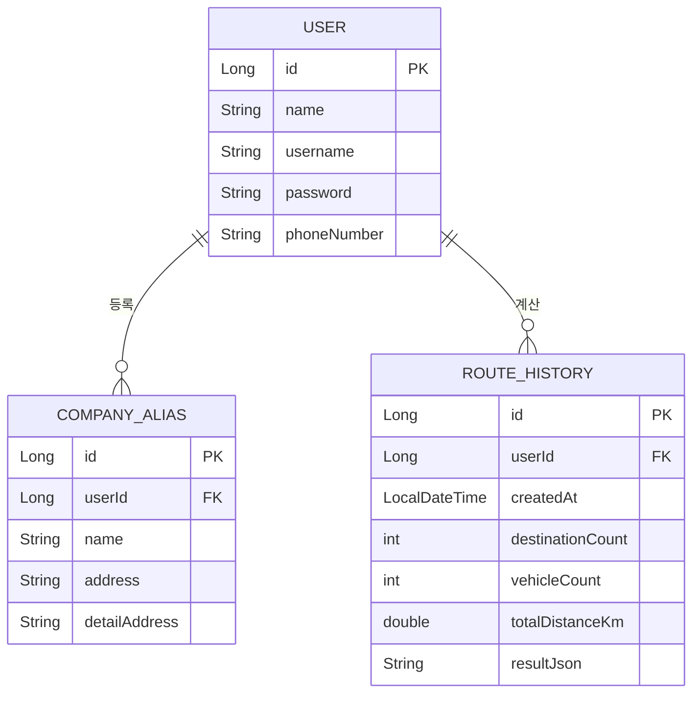

# PostalRoute

우체국 집하 차량의 동선을 자동으로 계산해주는 웹 서비스다. 집하지 주소, 파렛 수, 요청 시간을 입력하면 시간 약속을 지키면서 이동 거리를 최대한 줄이는 차량별 방문 순서를 계산해준다.

## ⅰ. 프로젝트 소개

### 1. 프로젝트 소개

우체국에서 근무하는 친구가 "아침마다 그날 가야 할 집하지 목록을 전달받으면, 수작업으로 대략 동선을 짜야 해서 비효율적이다"는 이야기를 한 게 시작이었다. 이러한 동선을 참고할 만한 서비스가 있으면 좋겠다는 이야기를 듣고, 그 계기로 동선을 참고할 만한 서비스를 만들어보기로 했다.

집하지 주소와 요청 시간, 파렛 수만 입력하면 시간 약속을 지키는 선에서 이동 거리가 가장 짧은 차량별 방문 순서를 자동으로 계산해주고, 실제 현장에서 종이 배차표와 같은 형식의 엑셀로 바로 내려받을 수 있도록 개발을 진행하였다.

### 2. 프로젝트 기능

**[동선 최적화]**
- 요청 시간이 있는 집하지는 그 시간 약속을 지키는 선에서 차량을 배정한다.
- 같은 시간대에 여러 곳을 가야 하면, 목적지 수가 적을 땐 모든 조합을 다 따져서 이동 거리가 가장 짧은 배정을 찾는다.
- 시간이 없는 집하지는 기존 경로에 끼워 넣었을 때 거리가 가장 적게 늘어나는 자리를 찾아 넣는다 (도착해서 싣고 내리는 시간까지 고려).
- 평파렛/롤파렛 적재 기준표를 기준으로 차량 톤수를 자동 배정하고, 한 차로 못 싣는 양이면 자동으로 여러 대로 나눈다.
- 어떤 차량에도 안 맞는 용량이면 조용히 틀린 값으로 넘어가지 않고, 화면과 엑셀에 경고로 표시한다.
- 엑셀 파일로 집하지 목록을 한 번에 가져올 수 있다 (등록된 업체명이면 주소도 자동으로 채워줌).

**[업체 관리]**
- 자주 쓰는 업체명과 주소를 등록해두면 동선 입력할 때 이름만으로 바로 찾을 수 있다.
- 엑셀로 한 번에 등록할 수도 있다.

**[이력 관리]**
- 계산했던 결과를 날짜별로 조회하고, 다시 불러와서 재계산하거나 삭제할 수 있다.

**[엑셀 다운로드]**
- 계산 결과를 실제 종이 배차표와 같은 형식(차량번호/용적/구간별 업체·시간·수량)으로 내려받을 수 있다.

### 3. 개발 환경

**[IDE]**


**[Backend]**


**[Database]**


**[API]**


**[Library]**


**[Frontend]**


**[Infra]**


## ⅱ. 구조 및 설계

### 1. 프로젝트 구조

```
postalroute
├── src/main/java/com/postalroute/backend
│   ├── BackendApplication.java   # 스프링 부트 시작점
│   ├── config/     # 공통 설정 (WebConfig 등)
│   ├── route/      # 동선 최적화 핵심 로직
│   ├── vehicle/    # 차량 톤수별 적재 기준표
│   ├── history/    # 이력 저장/조회/삭제
│   ├── company/    # 업체(주소록) 관리
│   └── user/       # 로그인/회원가입
│
└── src/main/resources
    ├── static/     # 화면 (로그인, 동선 최적화, 이력 관리, 업체 관리 등)
    └── application.properties.example
```

### 2. API 설계

**회원 (`UserController`)**

| Method | URL | 설명 |
|---|---|---|
| POST | `/api/signup` | 회원가입 |
| POST | `/api/login` | 로그인 (세션 생성) |
| POST | `/api/logout` | 로그아웃 |
| POST | `/api/find-id` | 아이디 찾기 |
| POST | `/api/find-pw/verify` | 비밀번호 찾기 1단계 (본인 확인) |
| POST | `/api/find-pw` | 비밀번호 재설정 |

**업체 관리 (`CompanyAliasController`)**

| Method | URL | 설명 |
|---|---|---|
| GET | `/api/companies` | 내가 등록한 업체 목록 조회 |
| GET | `/api/companies/search?keyword=` | 업체명으로 검색 |
| POST | `/api/companies` | 업체 등록 (이름/주소 중복 체크) |
| PUT | `/api/companies/{id}` | 업체 수정 |
| DELETE | `/api/companies/{id}` | 업체 삭제 |

**동선 최적화 (`RouteController`)**

| Method | URL | 설명 |
|---|---|---|
| POST | `/api/geocode` | 주소 → 좌표 변환 |
| POST | `/api/route/optimize` | 동선 최적화 실행 (로그인 상태면 이력 자동 저장) |

**이력 관리 (`RouteHistoryController`)**

| Method | URL | 설명 |
|---|---|---|
| GET | `/api/route/history?start=&end=` | 이력 목록 조회 (기간 미지정 시 오늘 하루치만) |
| GET | `/api/route/history/{id}` | 이력 상세 조회 (본인 이력만) |
| DELETE | `/api/route/history/{id}` | 이력 삭제 (본인 이력만) |

### 3. DB 설계



#### User

| 컬럼명 | 데이터 타입 | 조건 | 설명 |
|---|---|---|---|
| id | BIGINT | PK, NOT NULL, AI | 고유 증가값 |
| name | VARCHAR | NOT NULL | 이름 |
| username | VARCHAR | NOT NULL | 로그인 아이디 |
| password | VARCHAR | NOT NULL | 비밀번호 (암호화 저장) |
| phone_number | VARCHAR | NOT NULL | 전화번호 (아이디·비밀번호 찾기 본인 확인용) |

#### Company_Alias

| 컬럼명 | 데이터 타입 | 조건 | 설명 |
|---|---|---|---|
| id | BIGINT | PK, NOT NULL, AI | 고유 증가값 |
| user_id | BIGINT | NOT NULL | 등록한 회원 id (논리적 FK, 관계 미설정) |
| name | VARCHAR | NOT NULL | 업체명 |
| address | VARCHAR | NOT NULL | 주소 |
| detail_address | VARCHAR | | 상세주소 (없으면 NULL) |

#### Route_History

| 컬럼명 | 데이터 타입 | 조건 | 설명 |
|---|---|---|---|
| id | BIGINT | PK, NOT NULL, AI | 고유 증가값 |
| user_id | BIGINT | NOT NULL | 계산한 회원 id (논리적 FK, 관계 미설정) |
| created_at | DATETIME | NOT NULL | 계산한 시각 |
| destination_count | INT | NOT NULL | 입력한 집하지 개수 |
| vehicle_count | INT | NOT NULL | 배정된 차량 대수 |
| total_distance_km | DOUBLE | NOT NULL | 전체 이동 거리 합 |
| result_json | LONGTEXT | | 계산 결과(차량별 전체 경로) 저장, 상세보기·재계산·엑셀 다운로드에 재사용 |

## ⅲ. 실행 방법

### 1. 실행 방법

아래는 **Windows** 환경 기준 실행 방법이다.

1. MariaDB에 `postal_db` 데이터베이스를 만든다.
2. `src/main/resources/application.properties.example` 파일을 복사해서 같은 폴더에 `application.properties`로 만들고, 본인의 DB 비밀번호와 카카오 API 키를 입력한다.
   ```
   spring.datasource.url=jdbc:mariadb://localhost:3306/postal_db
   spring.datasource.username=root
   spring.datasource.password=본인_DB_비밀번호
   kakao.api.key=본인_카카오_API_키
   ```
3. PowerShell을 열고, 프로젝트 루트 폴더(`postalroute`)로 이동한다.
4. 아래 명령어로 실행한다.
   ```
   .\gradlew.bat bootRun
   ```
5. 브라우저에서 `http://localhost:8080/login.html` 로 접속한다.
